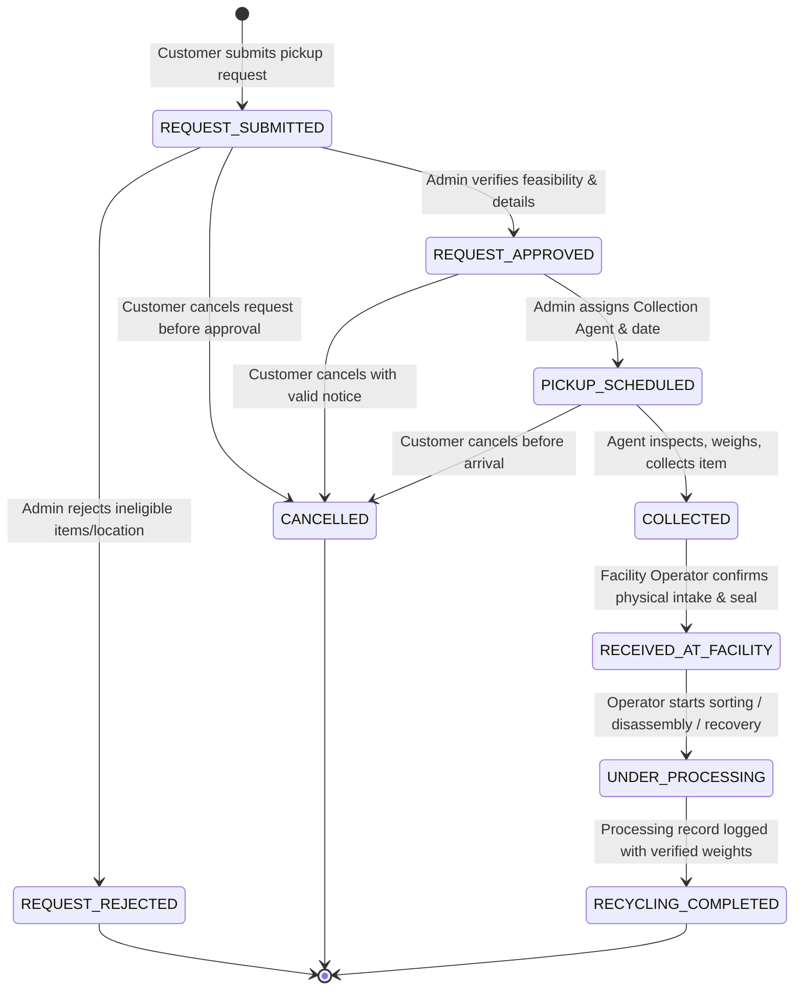

# ReTech — System Architecture & Design Specification

## 1. System Overview

**ReTech** is an enterprise-grade, full-stack E-Waste Collection and Recycling Tracking platform engineered with **Java 21**, **Spring Boot 4 / Spring Framework 7**, **Spring Data JPA**, **MySQL**, and a responsive **HTML5/CSS3/Vanilla JavaScript ES6** frontend.

The platform establishes an end-to-end digital custody chain for electronic waste disposal. It bridges the gap between individual households/businesses (Customers), mobile field logistics personnel (Collection Agents), industrial processing centers (Recycling Facility Operators), and administrative oversight teams (Administrators).

```mermaid
flowchart TB
    subgraph ClientLayer ["Client Layer (Browser ES6)"]
        UI_Customer["Customer Portal\n(dashboard.html, my-requests.html)"]
        UI_Agent["Collection Agent Portal\n(agent.html)"]
        UI_Facility["Recycling Facility Portal\n(facility.html)"]
        UI_Admin["Admin Operations Center\n(admin.html)"]
        UI_Public["Public Tracking & Centres\n(index.html, tracking.html, centres.html)"]
    end

    subgraph SecurityLayer ["Security & Routing Tier"]
        GW["Same-Origin Reverse Proxy / Static Resource Handler"]
        CSRF["Cookie CSRF Filter (XSRF-TOKEN)"]
        AUTH["Spring Security 7 Filter Chain\n(BCrypt, Role-Based Access Control)"]
    end

    subgraph ControllerLayer ["REST Controller Layer (/api/**)"]
        AC["AuthController"]
        UC["UserController"]
        CRC["CollectionRequestController"]
        AGC["AgentController"]
        FC["FacilityController"]
        CCC["CollectionCentreController"]
        ADM["AdminController"]
        SC["StatisticsController"]
    end

    subgraph ServiceLayer ["Business Logic & Workflow Domain Tier"]
        AS["AuthService"]
        US["UserService"]
        CRS["CollectionRequestService\n(State Machine Enforcer)"]
        AGS["AgentService"]
        FS["FacilityService"]
        PRS["ProcessingRecordService"]
        STS["StatisticsService"]
    end

    subgraph DataLayer ["Data Access & Relational Tier"]
        JPA["Spring Data JPA Repositories"]
        HIB["Hibernate 6 ORM"]
        FLY["Flyway Schema Migrations (V1, V2)"]
        DB[(MySQL 8.0+ Database)]
    end

    ClientLayer -->|HTTPS / REST API| GW
    GW --> CSRF
    CSRF --> AUTH
    AUTH --> ControllerLayer
    ControllerLayer --> ServiceLayer
    ServiceLayer --> JPA
    JPA --> HIB
    HIB --> DB
    FLY -.->|Versioned DDL/DML| DB
```

---

## 2. Architectural Principles & Patterns

### 2.1 Single-Origin Monolithic Web Architecture
The frontend assets (`index.html`, `login.html`, `dashboard.html`, `css/styles.css`, `js/app.js`, etc.) reside within `src/main/resources/static`.
- **Elimination of Cross-Origin Resource Sharing (CORS) Fragility:** Because static assets and REST controllers are served from identical host and port (`localhost:8080`), cookies (`JSESSIONID`, `XSRF-TOKEN`) enjoy first-party cookie isolation and strict SameSite compliance without fragile third-party origin policies.
- **Micro-dependency Footprint:** No Node.js runtime, Webpack/Vite bundlers, npm dependencies, or heavy SPA frameworks are needed in production, dramatically lowering memory footprint, CI/CD duration, and vulnerability surface area.

### 2.2 Layered Architecture & Separation of Concerns
1. **Presentation Tier (HTML5/CSS3/Vanilla JS ES6):** Asynchronous DOM interaction using native modern Web APIs (`fetch`, `FormData`, `URLSearchParams`, CSS Grid, Flexbox, CSS Variables).
2. **Controller Tier (`com.retech.controller`):** RESTful endpoints consuming and emitting strongly-typed Data Transfer Objects (DTOs), applying HTTP status semantics, validating input constraints with JSR-380 `@Valid`, and enforcing role authorization with Spring Security expressions (`@PreAuthorize`, `SecurityFilterChain`).
3. **Domain & Service Tier (`com.retech.service`):** Transaction boundary control (`@Transactional`), finite state machine logic, unique tracking ID generation, business calculations, and audit history creation.
4. **Data Access Tier (`com.retech.repository`):** Spring Data JPA repositories with parameterized query derivation, preventing SQL injection vulnerabilities.
5. **Persistence Tier (`com.retech.entity`):** Normalized entity definitions with JPA mappings, foreign key relations, unique index constraints, and cascading integrity rules.

---

## 3. Finite State Machine: Collection & Recycling Lifecycle

To prevent fraud, phantom recycling claims, and invalid stage skipping, ReTech implements a deterministic state machine:

### State Transition Validation Matrix
| Current State | Next Permitted States | Authorized Roles | Business Trigger & Rules |
| :--- | :--- | :--- | :--- |
| `REQUEST_SUBMITTED` | `REQUEST_APPROVED`, `REQUEST_REJECTED`, `CANCELLED` | `ROLE_ADMIN` (Approve/Reject), `ROLE_CUSTOMER` (Cancel) | Initial state upon creation. User can cancel. Admin can approve or reject. |
| `REQUEST_APPROVED` | `PICKUP_SCHEDULED`, `CANCELLED` | `ROLE_ADMIN` (Schedule), `ROLE_CUSTOMER` (Cancel) | Admin must specify designated `assignedAgent` and pickup date. |
| `PICKUP_SCHEDULED` | `COLLECTED`, `CANCELLED` | `ROLE_AGENT` (Collect), `ROLE_CUSTOMER` (Cancel) | Agent conducts doorstep physical inspection, records scale weight (`actualWeightKg`) and pickup timestamp. |
| `COLLECTED` | `RECEIVED_AT_FACILITY` | `ROLE_OPERATOR`, `ROLE_ADMIN` | Chain-of-custody handoff. Facility operator confirms receipt and intake integrity. |
| `RECEIVED_AT_FACILITY`| `UNDER_PROCESSING` | `ROLE_OPERATOR`, `ROLE_ADMIN` | Sorting, hazardous decontamination, battery depalletizing initiated. |
| `UNDER_PROCESSING` | `RECYCLING_COMPLETED` | `ROLE_OPERATOR`, `ROLE_ADMIN` | Final material recovery logged with explicit verified weights (reused, recycled, disposed). |
| `RECYCLING_COMPLETED`| None (Terminal) | - | Request permanently closed. Impact metrics added to verified aggregates. |
| `CANCELLED` | None (Terminal) | - | Permanently closed. No collection will take place. |
| `REQUEST_REJECTED` | None (Terminal) | - | Permanently closed. Customer informed of rejection reason. |

---

## 4. Role-Based Access Control (RBAC) Matrix

| Resource / Endpoint | `ROLE_CUSTOMER` | `ROLE_AGENT` | `ROLE_OPERATOR` | `ROLE_ADMIN` | Public / Unauth |
| :--- | :---: | :---: | :---: | :---: | :---: |
| `GET /index.html`, `/tracking.html`, `/centres.html` | Yes | Yes | Yes | Yes | Yes |
| `GET /api/statistics/public` | Yes | Yes | Yes | Yes | Yes |
| `GET /api/centres/search` | Yes | Yes | Yes | Yes | Yes |
| `GET /api/requests/track/{code}` | Yes | Yes | Yes | Yes | Yes |
| `POST /api/auth/register` (Customer only) | Yes | Yes | Yes | Yes | Yes |
| `POST /api/auth/login`, `POST /api/auth/logout` | Yes | Yes | Yes | Yes | Yes |
| `GET /api/users/me/profile`, `PUT /api/users/me/profile` | Yes | Yes | Yes | Yes | No |
| `POST /api/requests` (Create Request) | Yes | No | No | Yes | No |
| `GET /api/requests/my` (Own Requests) | Yes | No | No | Yes | No |
| `POST /api/requests/{id}/cancel` | Yes (Own) | No | No | Yes | No |
| `GET /api/statistics/customer` | Yes (Own) | No | No | Yes | No |
| `GET /api/agent/assignments` | No | Yes | No | Yes | No |
| `POST /api/agent/requests/{id}/collect` | No | Yes | No | Yes | No |
| `GET /api/facility/requests` | No | No | Yes | Yes | No |
| `POST /api/facility/requests/{id}/receive` | No | No | Yes | Yes | No |
| `POST /api/facility/requests/{id}/processing-records` | No | No | Yes | Yes | No |
| `GET /api/admin/**` (All admin controls) | No | No | No | Yes | No |
| `GET /api/admin/reports/export-csv` | No | No | No | Yes | No |

---

## 5. Security Architecture

1. **Password Protection:** Passwords are never stored in plaintext. They are salted and hashed using **BCrypt** with an adaptive work factor of 10 (`BCryptPasswordEncoder(10)`).
2. **CSRF Mitigation:** Dual-token CSRF architecture using Spring Security's `CookieCsrfTokenRepository.withHttpOnlyFalse()`. The server issues an `XSRF-TOKEN` cookie, and JavaScript reads it and injects it into the `X-XSRF-TOKEN` HTTP header on all state-altering requests (`POST`, `PUT`, `DELETE`).
3. **Session Management:** Standard HTTP servlet session (`JSESSIONID`) with `SameSite=Lax`, invalidation upon logout, and cookie deletion.
4. **Parameterized Persistence:** Spring Data JPA executes parameterized SQL via Hibernate PreparedStatements, completely neutralizing SQL Injection attacks.
5. **No Public Admin Creation:** Registration endpoint strictly binds `Role.ROLE_CUSTOMER`. System Administrators can only be provisioned through secure bootstrap configuration (`retech.bootstrap.admin.*`) or through an authenticated Admin user promoting accounts.
