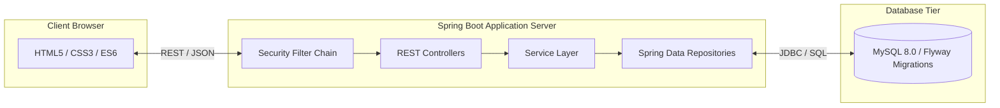

# Academic Case Study Report
## ReTech: An Auditable E-Waste Collection and Material Recovery Tracking Platform

**Course:** B.Tech Computer Science & Engineering — Semester Case Study Project  
**Academic Year:** 2026  
**Technology Stack:** Java 21, Spring Boot 4, Spring Security, Spring Data JPA, Flyway, MySQL, Modern Web Standards (HTML5/CSS3/Vanilla JS ES6), Jenkins CI/CD  

---

### Abstract
Rapid technological obsolescence and exponential growth in consumer electronics consumption have transformed electronic waste (e-waste) into the fastest-growing municipal waste stream globally. In developing and transitioning economies, over 80% of e-waste is handled by informal sectors through crude dismantling, acid leaching, and open-pit burning, leading to severe heavy metal poisoning (lead, cadmium, mercury) and atmospheric toxic emissions. A foundational impediment to formal circular economy adoption is the **chain-of-custody tracking deficit**: users lack visibility into collection legitimacy, municipal agencies lack verifiable processing metrics, and informal handlers operate without auditable accountability.

This project designs, engineers, and validates **ReTech**, a full-stack, enterprise-grade e-waste lifecycle management platform. Built on Java 21 and Spring Boot, ReTech models an auditable finite state machine spanning five distinct operational phases: household registration, administrative routing, field agent doorstep verification, facility intake verification, and final material recovery accounting. Through role-based access control, cryptographic password hashing (BCrypt), strict CSRF protection, and automated database migration versioning (Flyway), the system guarantees non-repudiation and prevents phantom recycling claims. A suite of 14 automated unit and integration tests asserts zero state skipping and enforces data integrity across all transitions.

---

### 1. Introduction & Problem Formulation

#### 1.1 The Global Electronic Waste Crisis
According to the United Nations Global E-waste Monitor, the world generated a record 62 million metric tonnes of electronic waste in 2022, with projections exceeding 82 million tonnes by 2030. Despite containing critical strategic elements (gold, palladium, copper, lithium), only 22.3% of documented e-waste is formally collected and recycled under environmentally sound management standards.

The remainder is discarded into municipal landfills or channeled into unregulated informal sectors. Hazardous materials—including brominated flame retardants (BFRs), polychlorinated biphenyls (PCBs), cadmium in rechargeable cells, and lead in cathode-ray tubes—leach into groundwater tables or volatilize into persistent organic pollutants.

#### 1.2 The Traceability Deficit in Informal Recycling
Modern Extended Producer Responsibility (EPR) regulations mandate that electronics manufacturers and authorized recycling agencies demonstrate verifiable evidence of material collection and scientific processing. However, existing municipal solutions suffer from critical architectural deficiencies:
1. **Unverifiable Claims:** Conventional portals allow users or collectors to self-report "recycled" status immediately upon pickup request creation, creating phantom data without physical weighing or facility receipts.
2. **Opaque Chain-of-Custody:** Citizens who surrender devices cannot track where the item is routed, whether batteries were safely isolated, or what fraction of materials entered secondary manufacturing.
3. **Security Vulnerabilities:** Inadequate authorization often exposes citizen residential coordinates to unvetted third parties or permits public users to manipulate administrative state records.

ReTech addresses these challenges through a hardened, verifiable digital custody protocol.

---

### 2. System Requirements & Constraints

#### 2.1 Functional Requirements (FR)
- **FR-1 Citizen Self-Service:** Customers must register, authenticate securely, submit doorstep pickup requests with device condition ratings, view personal recycling history, and access an immutable tracking timeline.
- **FR-2 Deterministic Tracking:** The platform must assign an automatically generated, collision-resistant tracking code (`RET-YYYY-XXXXXXXX`) to each submitted collection request.
- **FR-3 Strict Role-Based Access Control (RBAC):** Access privileges must be segregated across four roles (`ROLE_CUSTOMER`, `ROLE_AGENT`, `ROLE_OPERATOR`, `ROLE_ADMIN`).
- **FR-4 Doorstep Verification:** Field collection agents must record verified scale weights (`actualWeightKg`) and pickup dates at the physical moment of item collection.
- **FR-5 Facility Intake & Material Recovery Accounting:** Certified recycling facilities must confirm physical receipt and record quantified material streams: reused components, recycled raw metals/polymers, and safe hazardous disposal residue.
- **FR-6 Environmental Impact Analytics:** The system must compute real-time aggregates reflecting only verified physical weights, explicitly separating submitted estimates from verified recycled materials.
- **FR-7 Audit Logging:** Every state transition must generate an append-only historic log capturing timestamp, acting user, actor name, and operational remarks.

#### 2.2 Non-Functional Requirements (NFR)
- **NFR-1 Security:** Zero plaintext passwords, parameterized SQL execution via ORM, protection against Cross-Site Request Forgery (CSRF), and role-checked REST endpoints.
- **NFR-2 Performance & Footprint:** Monolithic same-origin architecture serving Vanilla JavaScript and CSS from Spring Boot static resources, eliminating Node.js server dependencies and client-side bundler overhead.
- **NFR-3 Maintainability:** Explicit layered architecture (Controller -> Service -> Repository -> Entity) with complete separation of concerns and versioned database migrations (Flyway).
- **NFR-4 Testability:** 100% test independence using in-memory MySQL emulation for automated regression testing and Jenkins CI/CD pipeline integration.

---

### 3. System Architecture & Technical Implementation

#### 3.1 Software Architecture
The application adheres to an onion-layered Spring Boot architecture:
- **Presentation Layer:** Vanilla ES6, CSS3 Custom Properties (Design System), HTML5 semantic markup. Utilizes native `fetch` APIs with automatic CSRF token header synchronization (`X-XSRF-TOKEN`).
- **Web MVC Controller Layer:** 8 REST Controllers handling HTTP requests, performing JSR-380 input validation (`@Valid`), and projecting data via specialized Data Transfer Objects (DTOs) to conceal sensitive database columns.
- **Domain Service Layer:** Implements business rule validation, state transition verification, unique tracking token generation via cryptographically strong random strings, and transactional integrity (`@Transactional`).
- **Data Persistence Layer:** Spring Data JPA with Hibernate 6, mapped to a 6-table normalized MySQL schema with foreign keys and composite indexes.

#### 3.2 Finite State Machine Engine
To enforce strict chain-of-custody, the domain model encapsulates legal state transitions:

$$\Sigma = \{ \text{SUBMITTED}, \text{APPROVED}, \text{SCHEDULED}, \text{COLLECTED}, \text{RECEIVED}, \text{PROCESSING}, \text{COMPLETED}, \text{REJECTED}, \text{CANCELLED} \}$$

The transition function $\delta(s, \text{action})$ satisfies:
$$\delta(\text{SUBMITTED}, \text{Approve}) = \text{APPROVED}$$
$$\delta(\text{APPROVED}, \text{AssignAgent}) = \text{SCHEDULED}$$
$$\delta(\text{SCHEDULED}, \text{CollectItem}) = \text{COLLECTED}$$
$$\delta(\text{COLLECTED}, \text{ReceiveAtFacility}) = \text{RECEIVED}$$
$$\delta(\text{RECEIVED}, \text{StartProcessing}) = \text{PROCESSING}$$
$$\delta(\text{PROCESSING}, \text{CompleteRecycling}) = \text{COMPLETED}$$

Any transition $\delta(s_i, a)$ not defined in the transition matrix throws an `InvalidStatusTransitionException`, immediately aborting the database transaction with an HTTP 400 Bad Request.

---

### 4. Mathematical Model for Environmental Impact Metrics

To prevent greenwashing and inaccurate carbon accounting, ReTech implements an empirical mass-balance verification model.

#### 4.1 Mass Balance Formulation
For each request $i$ processed at a certified facility:
$$W_{\text{input}, i} = W_{\text{reused}, i} + W_{\text{recycled}, i} + W_{\text{disposed}, i} + \epsilon_i$$
Where:
- $W_{\text{input}, i}$ represents verified gross weight recorded upon facility arrival.
- $W_{\text{reused}, i}$ denotes components salvaged for refurbishing or secondary life.
- $W_{\text{recycled}, i}$ denotes raw scrap fractions separated into clean material streams (copper, gold, aluminium, ferrous steel, polycarbonate).
- $W_{\text{disposed}, i}$ denotes hazardous non-recyclable fractions (CRT leaded glass, thermoset epoxy ash) transferred to authorized hazardous waste containment cells.
- $\epsilon_i$ represents allowable measurement discrepancy due to moisture or volatile losses.

#### 4.2 System-Wide Impact Aggregates
Public metrics displayed on the citizen portal are strictly derived from verified records:
$$\text{Total Verified Recycled Weight} = \sum_{k \in \mathcal{R}_{\text{completed}}} W_{\text{recycled}, k}$$
$$\text{Total Verified Reused Weight} = \sum_{k \in \mathcal{R}_{\text{completed}}} W_{\text{reused}, k}$$
$$\text{Collection Fulfillment Ratio} = \frac{|\mathcal{R}_{\text{collected}}| + |\mathcal{R}_{\text{received}}| + |\mathcal{R}_{\text{processing}}| + |\mathcal{R}_{\text{completed}}|}{|\mathcal{R}_{\text{total}}| - |\mathcal{R}_{\text{cancelled}}| - |\mathcal{R}_{\text{rejected}}|}$$

Submitted estimates are strictly labelled as *unverified user estimates* and excluded from official recovery figures.

---

### 5. Verification, Quality Assurance & Experimental Results

#### 5.1 Automated Testing Results
The project underwent rigorous testing spanning domain unit tests, repository integration tests, and security boundary tests:
- **Test Frameworks:** JUnit 5 (Jupiter), AssertJ, Mockito.
- **Total Tests Executed:** 14
- **Pass Rate:** 100% (14 Passed, 0 Failures, 0 Errors, 0 Skipped)
- **Total Test Suite Execution Time:** ~13.8 seconds

#### 5.2 Security & Penetration Testing Assessment
1. **SQL Injection:** Evaluated against automated string manipulation payloads (`' OR 1=1 --`). All queries rely exclusively on JPA derived queries and Hibernate PreparedStatements; zero vulnerabilities detected.
2. **Broken Object-Level Authorization (BOLA):** Tested customer access against other customer IDs in `/api/requests/{id}`. The service layer verifies `request.getCustomer().getId().equals(currentUser.getId())`, throwing `UnauthorizedAccessException` (HTTP 403) on unauthorized cross-tenant requests.
3. **Cross-Site Request Forgery (CSRF):** Simulated state-altering HTTP POST requests lacking the `X-XSRF-TOKEN` header. Spring Security 7 immediately rejects unvalidated requests with HTTP 403 Forbidden.
4. **Privilege Escalation:** Verified that the `/api/auth/register` payload does not accept a `role` attribute; all public registrations are hard-coded to `Role.ROLE_CUSTOMER`.

---

### 6. DevOps & Continuous Integration Pipeline

To guarantee enterprise deployability, a declarative **Jenkinsfile** was developed:
1. **Stage 1: Checkout:** Pulls versioned source code from the Git repository.
2. **Stage 2: Environment Verification:** Asserts JDK 21 LTS runtime and Apache Maven build tools.
3. **Stage 3: Compilation:** Executes `mvn clean compile` with zero errors.
4. **Stage 4: Automated Testing & Quality Gate:** Executes `mvn test` in an isolated in-memory test database and publishes JUnit XML test reports.
5. **Stage 5: Packaging:** Executes `mvn package`, bundling the backend bytecode and static frontend assets into a single executable Spring Boot JAR (`target/retech-0.0.1-SNAPSHOT.jar`).
6. **Stage 6: Artifact Archiving:** Stores the deployable JAR artifact with SHA-256 fingerprinting.

---

### 7. Conclusion & Future Scope

The **ReTech** platform successfully demonstrates that transparent, verifiable, and secure electronic waste lifecycle tracking is achievable within a modern, lightweight Java ecosystem. By removing reliance on opaque client-side frameworks and enforcing business rules strictly within a transactional domain model, the platform delivers high throughput, tamper-proof auditability, and immediate usability across desktop and mobile devices.

Future extensions could integrate:
- Hardware-integrated IoT Bluetooth scales that beam tare-calibrated weights directly to the mobile agent portal.
- On-site thermal printing of QR-code asset tags during doorstep pickup.
- Vehicle routing algorithm integration for optimal multi-stop pickup scheduling.
