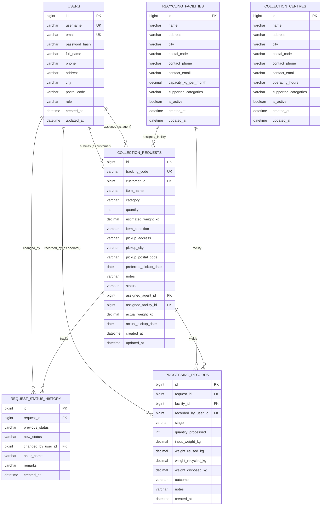

# ReTech — Database Design & Schema Specification

## 1. Overview & Design Principles

The ReTech database schema is designed following strict third normal form (3NF) principles, enforced with relational integrity, foreign key constraints, indexes, and audit timestamps. Database evolution is managed deterministically through **Flyway** migration scripts (`V1__init_schema.sql`, `V2__seed_demo_data.sql`).

### Key Design Pillars:
1. **Referential Integrity:** Enforced at the RDBMS layer (`FOREIGN KEY ... REFERENCES ... ON DELETE RESTRICT`).
2. **Deterministic Versioning:** No opaque automatic schema changes in production; every table and index definition is checked into version control.
3. **Audit Trail Immutability:** Status changes are recorded as append-only records in `request_status_history`, preserving historic timestamps and actors.
4. **Data Isolation & Security:** Passwords are stored exclusively as 60-character BCrypt hashes. Unique indexes enforce data uniqueness across emails, usernames, and public tracking codes.

---

## 2. Entity-Relationship (ER) Diagram

---

## 3. Data Dictionary & Table Specifications

### 3.1 Table: `users`
Stores user identities, contact coordinates, BCrypt password hashes, and access privileges.
| Column | Type | Nullable | Constraints / Index | Description |
| :--- | :--- | :---: | :--- | :--- |
| `id` | `BIGINT` | No | `PRIMARY KEY AUTO_INCREMENT` | Synthetic surrogate primary key |
| `username` | `VARCHAR(50)` | No | `UNIQUE INDEX idx_users_username` | Unique login username |
| `email` | `VARCHAR(100)`| No | `UNIQUE INDEX idx_users_email` | Unique primary email |
| `password_hash`| `VARCHAR(255)`| No | - | Salted BCrypt password digest (60 chars) |
| `full_name` | `VARCHAR(100)`| No | - | Legal/display name |
| `phone` | `VARCHAR(20)` | Yes | - | Contact phone number |
| `address` | `VARCHAR(255)`| Yes | - | Default street address |
| `city` | `VARCHAR(100)`| Yes | `INDEX idx_users_city` | User city |
| `postal_code` | `VARCHAR(20)` | Yes | - | Postal / PIN code |
| `role` | `VARCHAR(30)` | No | `INDEX idx_users_role` | `ROLE_CUSTOMER`, `ROLE_AGENT`, `ROLE_OPERATOR`, `ROLE_ADMIN` |
| `created_at` | `DATETIME` | No | - | Record creation timestamp |
| `updated_at` | `DATETIME` | No | - | Record last update timestamp |

### 3.2 Table: `collection_centres`
Public drop-off locations where citizens can drop off household electronic waste.
| Column | Type | Nullable | Description |
| :--- | :--- | :---: | :--- |
| `id` | `BIGINT` | No | `PRIMARY KEY AUTO_INCREMENT` |
| `name` | `VARCHAR(150)`| No | Public name of the collection depot |
| `address` | `VARCHAR(255)`| No | Physical street address |
| `city` | `VARCHAR(100)`| No | Filterable city (`idx_centres_city`) |
| `postal_code` | `VARCHAR(20)` | No | Postal code |
| `contact_phone`| `VARCHAR(20)` | Yes | Depot telephone contact |
| `contact_email`| `VARCHAR(100)`| Yes | Depot liaison email |
| `operating_hours`| `VARCHAR(100)`| Yes | Days & operating window (e.g., "Mon-Sat 09:00 - 18:00") |
| `supported_categories`| `VARCHAR(255)`| Yes | Comma-delimited list of accepted e-waste categories |
| `is_active` | `TINYINT(1)` | No | Default `1` (Active/Inactive toggle) |
| `created_at` | `DATETIME` | No | Creation timestamp |
| `updated_at` | `DATETIME` | No | Modification timestamp |

### 3.3 Table: `recycling_facilities`
Certified industrial material recovery facilities with specialized processing lines.
| Column | Type | Nullable | Description |
| :--- | :--- | :---: | :--- |
| `id` | `BIGINT` | No | `PRIMARY KEY AUTO_INCREMENT` |
| `name` | `VARCHAR(150)`| No | Facility enterprise name |
| `address` | `VARCHAR(255)`| No | Physical industrial location |
| `city` | `VARCHAR(100)`| No | City (`idx_facilities_city`) |
| `postal_code` | `VARCHAR(20)` | No | Postal code |
| `contact_phone`| `VARCHAR(20)` | Yes | Official contact number |
| `contact_email`| `VARCHAR(100)`| Yes | Facility dispatcher email |
| `capacity_kg_per_month` | `DECIMAL(10,2)` | Yes | Monthly throughput capacity in kg |
| `supported_categories` | `VARCHAR(255)` | Yes | Material streams processed (e.g. "LAPTOPS_COMPUTERS,BATTERIES") |
| `is_active` | `TINYINT(1)` | No | Active toggle (`idx_facilities_active`) |
| `created_at` | `DATETIME` | No | Record creation timestamp |
| `updated_at` | `DATETIME` | No | Record update timestamp |

### 3.4 Table: `collection_requests`
Primary lifecycle entity linking customer items, field logistics, and facility processing.
| Column | Type | Nullable | Constraints | Description |
| :--- | :--- | :---: | :--- | :--- |
| `id` | `BIGINT` | No | `PRIMARY KEY AUTO_INCREMENT` | Surrogate primary key |
| `tracking_code`| `VARCHAR(32)` | No | `UNIQUE INDEX idx_requests_tracking` | Public alphanumeric tracking identifier (`RET-YYYY-XXXXXXXX`) |
| `customer_id` | `BIGINT` | No | `FOREIGN KEY (users.id)` | Submitting customer |
| `item_name` | `VARCHAR(150)`| No | - | Free-text device make and model |
| `category` | `VARCHAR(50)` | No | `INDEX idx_requests_category` | E-waste category enum |
| `quantity` | `INT` | No | - | Number of units (> 0) |
| `estimated_weight_kg` | `DECIMAL(8,2)` | Yes | - | Customer's unverified estimated weight |
| `item_condition` | `VARCHAR(50)`| No | - | Working condition enum |
| `pickup_address` | `VARCHAR(255)`| No | - | Doorstep collection street address |
| `pickup_city` | `VARCHAR(100)`| No | `INDEX idx_requests_city` | City of collection |
| `pickup_postal_code` | `VARCHAR(20)` | No | - | Postal code |
| `preferred_pickup_date`| `DATE` | Yes | - | Customer preferred collection date |
| `notes` | `TEXT` | Yes | - | Special handling notes / hazards |
| `status` | `VARCHAR(40)` | No | `INDEX idx_requests_status` | Current lifecycle state enum |
| `assigned_agent_id` | `BIGINT` | Yes | `FOREIGN KEY (users.id)` | Field agent assigned to collect |
| `assigned_facility_id` | `BIGINT` | Yes | `FOREIGN KEY (recycling_facilities.id)` | Destination facility |
| `actual_weight_kg` | `DECIMAL(8,2)` | Yes | - | Verified physical scale weight in kg |
| `actual_pickup_date` | `DATE` | Yes | - | Date item was physically collected |
| `created_at` | `DATETIME` | No | `INDEX idx_requests_created` | Timestamp request submitted |
| `updated_at` | `DATETIME` | No | - | Timestamp last altered |

### 3.5 Table: `request_status_history`
Append-only chronological audit log of all state transitions.
| Column | Type | Nullable | Constraints | Description |
| :--- | :--- | :---: | :--- | :--- |
| `id` | `BIGINT` | No | `PRIMARY KEY AUTO_INCREMENT` | Audit log surrogate key |
| `request_id` | `BIGINT` | No | `FOREIGN KEY (collection_requests.id)` | Target request |
| `previous_status` | `VARCHAR(40)` | Yes | - | Preceding status (null on first creation) |
| `new_status` | `VARCHAR(40)` | No | - | Newly transitioned status |
| `changed_by_user_id`| `BIGINT` | Yes | `FOREIGN KEY (users.id)` | Acting user account (if authenticated) |
| `actor_name` | `VARCHAR(100)`| No | - | Display name of actor |
| `remarks` | `VARCHAR(255)`| Yes | - | Reason / operational notes for transition |
| `created_at` | `DATETIME` | No | `INDEX idx_history_request` | Event timestamp |

### 3.6 Table: `processing_records`
Physical material recovery and breakdown logs produced by facility operators.
| Column | Type | Nullable | Constraints | Description |
| :--- | :--- | :---: | :--- | :--- |
| `id` | `BIGINT` | No | `PRIMARY KEY AUTO_INCREMENT` | Surrogate key |
| `request_id` | `BIGINT` | No | `FOREIGN KEY (collection_requests.id)` | Request processed |
| `facility_id` | `BIGINT` | No | `FOREIGN KEY (recycling_facilities.id)`| Certified processing facility |
| `recorded_by_user_id`| `BIGINT` | No | `FOREIGN KEY (users.id)` | Certified operator |
| `stage` | `VARCHAR(40)` | No | - | `SORTING`, `DISASSEMBLY`, `RECOVERY`, etc. |
| `quantity_processed` | `INT` | No | - | Verified unit count |
| `input_weight_kg` | `DECIMAL(8,2)`| No | - | Verified gross intake weight |
| `weight_reused_kg` | `DECIMAL(8,2)`| Yes | - | Salvaged functional parts |
| `weight_recycled_kg`| `DECIMAL(8,2)`| Yes | - | Raw materials recovered (Cu, Al, Gold, ABS) |
| `weight_disposed_kg`| `DECIMAL(8,2)`| Yes | - | Hazardous / non-recyclable residue |
| `outcome` | `VARCHAR(50)` | No | - | Processing outcome enum |
| `notes` | `TEXT` | Yes | - | Environmental compliance notes |
| `created_at` | `DATETIME` | No | `INDEX idx_records_request` | Verification timestamp |

---

## 4. Flyway Migration Versioning

- **`V1__init_schema.sql`:** Creates the 6 relational tables with all foreign keys, composite checks, and optimized B-Tree indexes.
- **`V2__seed_demo_data.sql`:** Populates 4 community collection centres across Metro City and 3 certified regional recycling facilities.
